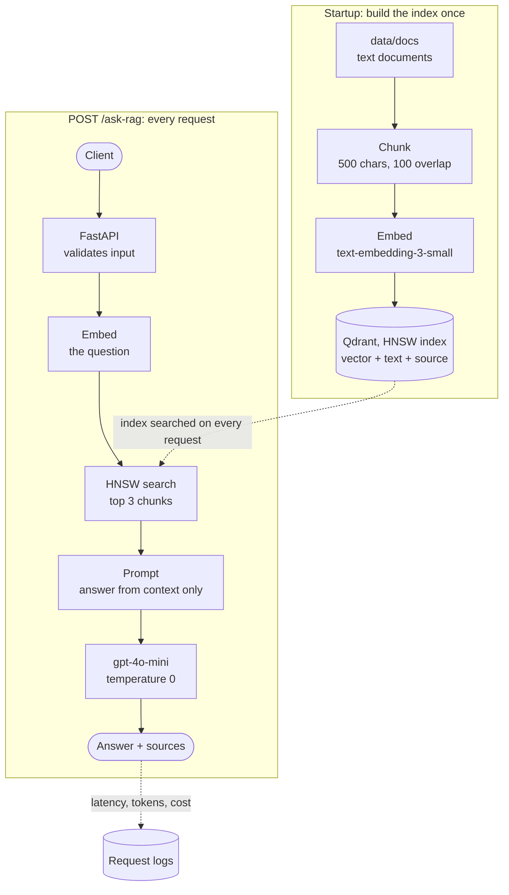
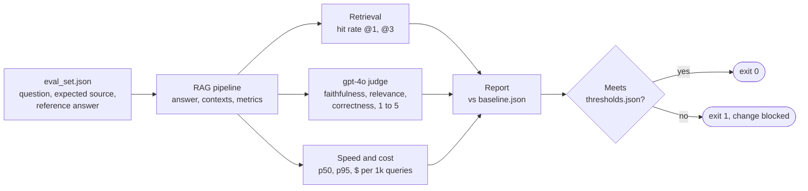

# RAG Doc Assistant

[](https://github.com/Chafic123/rag-doc-assistant/actions/workflows/ci.yml)


A retrieval-augmented generation (RAG) service that answers questions from a set of
documents, cites its sources, and **measures its own quality, speed and cost on every change**.

- **Grounded answers with citations.** The model answers only from retrieved context and
  says it does not know when the documents do not cover the question.
- **An evaluation gate, not a demo.** A ground-truth question set, retrieval hit rates and an
  LLM-as-judge are compared against a committed baseline. A change that drops quality,
  slows the p95 or raises the cost per query fails, like a failing unit test.
- **Every query is measured.** Latency per stage (embed, search, generate) and cost from
  token usage, logged on every request.
- **Built like a production service.** FastAPI, Qdrant with tuned HNSW, central config,
  unit tests with mocks, a secret scan, Docker and CI.

## Results

<!-- results:start -->
_Generated from `evals/baseline.json` by `make readme-results`._
<!-- results:end -->

## Architecture



1. **Ingest (once, at startup).** Every document is split into overlapping chunks, each chunk is
   embedded, and the vectors are stored in Qdrant together with their text and source file.
2. **Retrieve.** The question is embedded with the same model, and HNSW returns the 3 most
   similar chunks by cosine similarity without comparing against every vector.
3. **Augment and generate.** The chunks go into a prompt that only allows answers from that
   context. The response includes the source files, so every answer can be checked.

## How evaluation works



Every run prints the same report: each metric, the baseline value, the change, and the gate.

```
metric           this run  baseline    change         gate
------------------------------------------------------------------------
hit_rate@1            85%       80%    +5 pts  better >= 70%     PASS
faithfulness          90%       95%    -5 pts  worse  >= 80%     PASS
p95_latency_s       2.10s     2.40s    -0.30s  better <= 5.00s   PASS
cost_per_1k_usd    $0.101    $0.095   +$0.006  worse  <= $0.500  PASS
------------------------------------------------------------------------
RESULT: PASS, all 7 checks met.

Latency by stage (avg): embed 205 ms | search 3 ms | generate 990 ms
Cost of this run: answers $0.0020 (20 queries) + judge $0.1140 (60 calls) = $0.1160
```
<sub>Illustrative output. The real numbers are in the Results table above.</sub>

- **Baseline** (`evals/baseline.json`, committed): the accepted numbers every run is compared to.
- **Thresholds** (`evals/thresholds.json`): the minimum quality and the latency and cost budget.
  A full run that misses one exits with code 1. Runs with `--limit` are smoke tests and never gate.
- **History**: every run is saved to `evals/results/` with its config and the judge's reasons.

## Design decisions

| Decision | Why | Trade-off |
|---|---|---|
| Qdrant with explicit HNSW (`m=16`, `ef_construct=100`, `hnsw_ef=64`) | Approximate search visits a small part of a graph instead of every vector, so it scales to millions of chunks | Approximate, so recall can drop slightly. Local mode allows one process (production would use the Qdrant server) |
| Chunks of 500 characters with 100 overlap | Small enough to retrieve precisely, overlap keeps facts that cross a boundary | Character splits can cut sentences. Token or semantic chunking is a next step |
| Prompt restricted to the retrieved context, temperature 0 | Answers stay grounded and repeatable, so eval runs are comparable | Refuses questions the documents do not cover, even easy ones |
| Judge stronger than the generator, one rubric per metric, reason before score | Avoids self-grading, keeps metrics independent, makes the score explainable | The judge costs more than serving (about $0.11 per full run) and is not yet calibrated against human labels |
| Quality, p95 latency and cost all gated | A cheaper or faster change must not silently lower quality, and the reverse | Thresholds need updating when the eval set or models change |
| Cost from `response.usage` and a price table | OpenAI returns tokens, not money, so cost is exact and computed per query | Prices change: `app/costs.py` must be kept current (a test fails if a configured model has no price) |

## Quickstart

```bash
git clone https://github.com/Chafic123/rag-doc-assistant.git
cd rag-doc-assistant
python3 -m venv .venv && source .venv/bin/activate
make install
cp .env.example .env        # then put your OpenAI key in .env (never in .env.example)
make run                    # API docs at http://127.0.0.1:8000/docs
```

Or with Docker: `make docker-build && make docker-run`.

```bash
curl -X POST http://127.0.0.1:8000/ask-rag \
  -H "Content-Type: application/json" \
  -d '{"prompt": "What does HNSW stand for?"}'
```

```json
{ "answer": "...", "sources": ["vector_search.txt"] }
```

Each request also logs one line:
`ask-rag total_ms=1163 embed_ms=210 search_ms=3 generate_ms=950 tokens_in=408 tokens_out=50 cost_usd=0.000090`

## Commands

| Command | What it does |
|---|---|
| `make run` | start the API with auto-reload |
| `make test` | unit tests and secret scan, no API key needed |
| `make eval` | full evaluation, report vs baseline, exit 1 below a threshold (stop the API first: Qdrant local mode allows one process) |
| `make eval-quick` | the same on the first 3 questions, never gates |
| `make eval-retrieval` | retrieval only (hit rates), almost free |
| `make eval-baseline` | full evaluation, saved as the new baseline |
| `make readme-results` | write the baseline numbers into the Results table |
| `make docker-build` / `make docker-run` | build and run the container |

## Project structure

```
app/                     the service
  main.py                FastAPI app, routers, builds the index at startup
  config.py              every setting in one place, read from the environment
  llm.py                 one shared OpenAI client
  costs.py               model prices, tokens to dollars
  schemas.py             request and response models
  api/routes/            HTTP layer: health.py, rag.py (logs latency and cost)
  rag/
    ingest.py            load documents, split into chunks
    store.py             embeddings, Qdrant index (HNSW), search
    pipeline.py          retrieve, augment, generate, timed and priced per query
evals/                   quality measurement (not shipped in the image)
  eval_set.json          ground truth: question, expected source, reference answer
  judge.py               LLM-as-judge with structured outputs
  run_evals.py           runs the evaluation, prints the report, applies the gate
  report.py              summary, change vs baseline, thresholds
  readme_results.py      writes the Results table from the baseline
  thresholds.json        minimum quality, latency and cost budget
  baseline.json          the accepted numbers
tests/                   unit tests with fakes for OpenAI and Qdrant, plus a secret scan
data/docs/               the document corpus
.github/workflows/ci.yml tests on every push
Dockerfile, Makefile, .env.example
```

## Limitations and next steps

- **Small benchmark.** 7 short documents and 20 questions show the method works end to end.
  They are not a claim about large corpora. Next: a larger, harder set with multi-document
  and unanswerable questions.
- **Retrieval is single-stage.** Next: a cross-encoder reranker and hybrid search (BM25 + vectors),
  each measured against this baseline.
- **The judge is not calibrated yet.** Next: grade a sample by hand and compare, and add RAGAS
  as a second opinion.
- **p95 over 20 queries is a rough estimate.** Production request logs give the real tail.
- **Not yet production-hardened.** No authentication, rate limiting or streaming, and Qdrant runs
  in local mode.

## Tech stack

Python 3.14, FastAPI, Pydantic, OpenAI (`text-embedding-3-small`, `gpt-4o-mini`, `gpt-4o` as judge),
Qdrant (HNSW), pytest, Docker, GitHub Actions.

## License

MIT. Built by [Chafic Achour](https://www.linkedin.com/in/chafic-achour).
